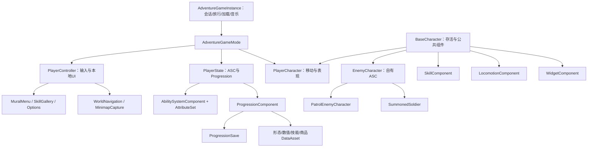

# C++ 架构审计与优化路线

核对日期：2026-10-25。范围为项目 Source/CrashCourse 的全部69个UCLASS及其实现、配置、脚本、蓝图/数据资产依赖；不是只按C++搜索结果判断是否使用。

## 结论

当前有可以沿用的核心结构：PlayerState持有玩家ASC和成长状态，Pawn负责表现/移动，四槽由SkillComponent管理，数值和形态使用DataAsset。此阶段适合在原结构上收敛职责，不建议整体推倒或为了“整洁”立即拆成很多模块。

69类分为56个当前主链类、4个仍有依赖的兼容类、2个编辑工具类、1个备用菜单、1个预留后端和5个清理候选。后四类不等于“可以删除”：蓝图父类、异步节点、原生动态加载和外部配置都可能保留间接入口。此次没有删除、改名或重设任何蓝图父类。

优先顺序：先完善存档触发和统一战斗结算，再收敛技能参数与NPC职责，最后整理UI、资产配置和编辑工具模块。不要先改存档里的FormId/SkillId，或直接将兵人换成玩家类。

## 证据与边界

- 静态清单覆盖69类，69份父类文档均存在。完整证据：[CPP类清单.json](CPP类清单.json)。
- 资产注册表扫描4250个/Game资产；以首页、三地区、当前主角/控制器/PlayerState/HUD及菜单数据为根，依赖闭包3793个包。
- 另外核对127个直接引用CrashCourse脚本模块的资产包中保存的原生类名，以补充蓝图图表、异步节点和动画通知等不出现在父类标签中的引用。完整证据：[蓝图与资源引用清单.json](蓝图与资源引用清单.json)。
- 数据资产统计为44个SkillDefinition、22个SkillLoadout、6个FormDefinition、6个UpgradeDefinition、1个CombatBalance、1个LocomotionLibrary、2个MenuArtData和1个SkillGalleryData。当前玩家可装备目录是39项；数量差异不等于其余资产无效，独立普攻和敌人定义另有入口。
- “依赖可达”表示资产会被引用，不能证明某个节点实际执行；“未检出引用”也不是立即删除的证明。注册表不等于运行调用跟踪，序列化类名也可能来自旧节点。
- 未执行PIE、游戏启动、切图或玩家存档读写；本次只进行源码/资源审计和编译。构建结果在文末记录。

## 当前结构

这张图描述当前职责和继承，不代表已经实施下面建议的新模块。

## 已直接处理的四处问题

| 问题 | 修改 | 行为边界 |
|---|---|---|
| 控制器把输入MappingContext复制到LocalPlayer子系统，却没有在EndPlay移除；LocalPlayer可以跨图存在 | 增加ReleaseRuntimeInputContexts，在EndPlay与重新安装映射前移除本控制器创建的副本 | 只移除RuntimeContexts，不清除其他系统的映射；需游戏内反复切图联调 |
| BP_ProgressionController的bShowProgressionPanel为true，旧F1–F12调试绑定原先不受Shipping/Test限制 | 为整组旧调试快捷键加入与0/9一致的非Shipping/Test编译条件 | 保留开发版本调试能力，不改正常1–4/J/E/Shift/Tab/M/N |
| Shipping编译实际失败：CC_MeleeAttack调用被发布版本禁用的DrawDebugSphereTraceMulti | 用ENABLE_DRAW_DEBUG保护这段绘图 | 不改变扫击或伤害事件，仅修复发布构建边界 |
| CC_BlueprintLibrary包含未使用的InterchangeTranslatorBase、ToolContextInterfaces和Chaos形变头文件 | 移除三项，显式包含实际使用的DrawDebugHelpers | 不修改旧蓝图函数签名或结算逻辑 |

即使暂时未使用的.cpp也会参与模块编译，因此旧近战通知的Shipping错误仍然必须处理。

## 需要优先优化的架构

### P1：存档需要有统一的“何时保存”策略

证据：ProgressionComponent.AddExperience/AddCopperCoins主要更新内存、刷新数值和广播；自动持久化主要发生在地区进入/切图，另有菜单手动保存。GameInstance.Shutdown目前清理音乐和代理，没有补写角色进度。

因此，新获经验或铜币后，如果既不手动保存也不切图就结束游戏，新增余额存在未落盘风险。这是静态代码发现的触发缺口，不是数据库未启动造成的；当前后台经验接口没有自动参与本地存档。

建议保留Progression作为运行数据拥有者，将持久化时机集中到一个会话存档服务：
1. OnChanged只标记Dirty，短延迟合并保存，避免每颗经验球同步写一次磁盘。
2. 主动退出/切图前尽可能提交有效快照；异常退出只能依赖之前已完成的保存。
3. 保留“恢复失败不覆盖旧档”和开发预设禁用自动覆盖的现有保护。
4. 保持当前v4数据及v1–v3迁移，后端接入另作明确的数据权威切换。

本轮未改变玩家档案格式、余额或保存时机。重点代码：[ProgressionComponent](../../Source/CrashCourse/Private/Progression/CC_ProgressionComponent.cpp)、[AdventureGameInstance](../../Source/CrashCourse/Private/World/CC_AdventureGameInstance.cpp)。

### P1：新旧伤害链与阵营规则应收敛

当前新链为ConfiguredAbility/SkillProjectile → DamageEffect.IncomingDamage → AttributeSet，包含防御、护盾、无敌和奖励。旧BlueprintLibrary.SendDamageEventToPlayer仍接受任意DamageEffect，并在实际结算前按“生命-Damage”判断死亡事件。它不能保证与新链的减伤/盾/无敌结果一致。

同时，AreAllies依赖是否有Player Actor Tag，而旧投射物/近战通知直接认PlayerCharacter类型。兵人被标记为玩家方，但不是PlayerCharacter，扩展友军、第三方阵营或新敌人类型时容易出现不同规则。

建议分两步：
1. 在保留旧蓝图函数接口的前提下，逐步将结算转入统一IncomingDamage链；死亡/受击表现由实际结算结果触发，避免提前按原始伤害决定死亡。
2. 引入小范围的阵营接口/TeamId适配，先兼容既有Player标签，再由玩家、敌人和兵人共同提供阵营。不要仅用继承类型区分友军。

旧函数仍有兼容依赖，本轮没有直接替换伤害算法或删掉旧GA。

### P1：技能执行参数还没有完全统一

有DataAsset驱动的20类Behavior模板，也有后来加入的DesignMechanic分支；同一UCC_ConfiguredAbility跨CC_ConfiguredAbility.cpp、CC_DesignSkillAbility.cpp实现，状态和召唤又进入SkillComponent。

存在明确的参数双来源：蓄力伤害2–4倍、重力首尾伤害0.4/0.8倍仍在代码中；召唤数值在兵人类配置，而技能说明来自设计表的静态文本。改美术面板参数或文字不一定改变实际机制。

建议继续共用SkillDefinition和四槽系统，将上述数值补入清晰的机制参数，数值简介从实际参数生成；仅对复杂机制拆少量GameplayAbility或执行策略，不要为39个资产逐一创建空壳C++类。保留现有SkillId和已装备存档。

### P2：兵人应逐步脱离“敌人”语义，仍然保持AI Pawn

当前SummonedSoldier继承EnemyCharacter，是为了复用独立ASC、健康监听、尸体清理；BaseCharacter的死亡清理和AttributeSet的奖励也会通过EnemyCharacter类型判断。兵人ExperienceReward=0暂时隔开了奖励，但类型含义仍然混杂。

后续可以抽取一个很薄的CombatNPCCharacter承担自有ASC/属性和公共生命流程，再由Enemy与Companion承载各自奖励/归属。或者先抽公共ASC初始化与阵营接口，再决定是否需要新父类。同步迁移死亡清理和奖励接口后再重设继承。

不要直接继承PlayerCharacter：玩家ASC来源于PlayerState，还包含镜头、疾跑、复活和本地控制逻辑，兵人只需要AI、战斗与主人归属。目前独立ASC的思路可保留。

### P2：成长组件与GameInstance职责较多

ProgressionComponent同时承担钱包、形态、永久商品、配装、外观、快照、存档迁移与开发预设；AdventureGameInstance同时承担地区目录、权限、读图、存档会话、开场和全局音乐。文件长度只是线索，职责之间的变化原因才是拆分依据。

建议保持原蓝图门面接口，内部按顺序抽取：
- 存档编解码与保存时机；
- 商店/进化事务校验与提交；
- 形态外观应用；
- 音乐会话组件；
- 旅行目录与加载状态。

每次拆分保证旧接口、稳定ID和RPC权限不变，逐项验证，不一次迁移所有类。当前单Runtime模块规模尚可，暂不为每个功能新增模块。

### P2：正式UI与备用UI要明确维护边界

当前BP_ProgressionController.ProgressionMenuClass指向WBP_MuralMenu，正式技能页使用SkillGalleryWidget，设置使用OptionsWidget。ProgressionMenu是缺少菜单配置时的原生文字回退；MuralMenu内部也仍保留没有Gallery数据时的简版技能页。

这些不是当前两个菜单同时打开，但会形成重复规则和文案。建议正式美术UI稳定后，将备用菜单标为仅开发用途，并统一只读UI数据/操作接口；之后再决定是否移除。余额、形态、技能组由现有事件刷新，冷却才保留定时刷新，不必每0.1秒重算整页说明。

ProgressionHUD也并非完全废弃：BP_MuralHUD虽然关闭调试面板，左下角拾取提示仍由它绘制。不能直接删除或把整个HUD置空。

### P3：编辑工具与运行时、路径配置可以继续整理

AnimationSetupLibrary和ExperienceFXSetupLibrary由Python配置脚本使用，运行游戏没有调用不代表无用。编辑器实现已经用WITH_EDITOR隔离，目前无需删类。后续可建一个Editor模块承接生成/修复代码，但需保留脚本入口或配置重定向。

GameMode和若干UI/兵人类内仍有写死的资源路径，地区和形态使用Rest/Town/Arena、Native/Artifact_01等历史ID。后续集中到一份项目设置/目录DataAsset并验证Cook依赖即可，不必现在引入完整插件框架；ID改名必须带存档迁移。

当前AI定时全局找角色、经验球使用Actor驱动Niagara视觉，在现有测试规模可工作。应先用实际场景规模测量，再决定引入感知/空间查询或经验球合批；本次没有性能采样，不能据代码形态承诺帧率收益。

## 未接入、备用与清理候选

| 类/系统 | 判定 | 处理建议 |
|---|---|---|
| ExperienceBackendSubsystem + Backend | 自动创建的适配器，但未发现当前原生调用或资产序列化调用证据；未自动接入 | 保留，符合此前预留后端需求。先做本地存档时机，再决定账号与云端权威，不要双向直接覆盖钱包 |
| ProgressionMenu | 现有Controller明确保留的回退入口 | 标注备用，不当作无用类删除 |
| AnimationSetupLibrary / ExperienceFXSetupLibrary | Python确实调用的编辑工具 | 保留；后续拆Editor模块 |
| GameplayAbility / SearchForTarget / WaitGameplayEvent / BlueprintLibrary | 旧GA或原生链仍依赖 | 兼容层，先迁移引用后清理 |
| ACC_Projectile | 未发现外部C++、蓝图父类或检查范围内的序列化原生类名 | 候选，先确认旧投射物资产/动态加载是否仍需支持 |
| UCC_Primary | 同上；名字相近的GA_Primary实际继承CC_GameplayAbility | 候选，名称相近不构成使用证据 |
| UCC_HitReact | 未检出上述使用证据；旧GA_HitReact也不是其子类 | 候选，先核对旧受击动画/蓝图函数调用 |
| UCC_MeleeAttack | 未检出外部原生/通知序列化引用；仍参与编译 | 候选，检查全部动画通知后再删 |
| UCC_AttributeChangeTask | 当前WidgetComponent已用直接委托绑定；未检出该旧节点使用 | 候选；若重新启用，先补异步任务持有/生命周期和显式EndTask约定 |

没有证据支持“删掉某个未调用父类就能明显提升游戏性能”。闲置类更主要增加维护和构建负担；运行中的全局扫描、重复上下文、同步加载和频繁UI刷新才需要实测关注。

## 全部69类逐项结论

证据列依次为：外部C++引用文件数 / 原生DataAsset或蓝图父类条目数 / 含序列化原生类名的资产包数 / 配置脚本数。共用头文件中的效果类与执行器同文件调用也计入C++证据；计数不是运行调用次数。每行类名链接到原有操作配置文档。

| 类 | 直接父类 | 判定 | 职责/处理 | C++ / 资产 / 序列化 / 脚本 |
|---|---|---|---|---|
| [ACC_AdventureGameMode](../CPPClasses/ACC_AdventureGameMode.md) | AGameModeBase | 当前主链 | 三地区框架与迁入门户兼容 | 1 / 0 / 0 / 1 |
| [ACC_BaseCharacter](../CPPClasses/ACC_BaseCharacter.md) | ACharacter, IAbilitySystemInterface | 当前主链 | 存活、公共组件、死亡布娃娃与属性生命周期 | 27 / 0 / 0 / 0 |
| [ACC_CoinPickup](../CPPClasses/ACC_CoinPickup.md) | ACharacter | 当前主链 | 铜钱状态机、巡逻、触碰铜币/经验结算 | 0 / 1 / 1 / 2 |
| [ACC_EnemyCharacter](../CPPClasses/ACC_EnemyCharacter.md) | ACC_BaseCharacter | 当前主链 | NPC自有ASC、生命监听和数值档案 | 7 / 3 / 3 / 6 |
| [ACC_ExperienceOrb](../CPPClasses/ACC_ExperienceOrb.md) | AActor | 当前主链 | 经验球散射、吸附与逐颗结算 | 3 / 0 / 0 / 0 |
| [ACC_ExperiencePack](../CPPClasses/ACC_ExperiencePack.md) | AActor | 当前主链 | 黑色经验包的E交互 | 2 / 1 / 1 / 1 |
| [ACC_FormArtifact](../CPPClasses/ACC_FormArtifact.md) | AActor | 当前主链 | 场景信物Actor，自动挂器物组件 | 0 / 5 / 5 / 4 |
| [ACC_FormPowerOrb](../CPPClasses/ACC_FormPowerOrb.md) | ACC_ExperienceOrb | 当前主链 | 元素能力球、解锁与50经验 | 3 / 0 / 0 / 0 |
| [ACC_MainMenuController](../CPPClasses/ACC_MainMenuController.md) | APlayerController | 当前主链 | 独立首页输入与焦点 | 1 / 0 / 0 / 0 |
| [ACC_MainMenuGameMode](../CPPClasses/ACC_MainMenuGameMode.md) | AGameModeBase | 当前主链 | 首页游戏框架，保持无玩家Pawn | 1 / 0 / 1 / 2 |
| [ACC_MapPortal](../CPPClasses/ACC_MapPortal.md) | AActor | 当前主链 | 休憩之地首次前往小镇的碰触入口 | 3 / 0 / 0 / 0 |
| [ACC_MinimapCapture](../CPPClasses/ACC_MinimapCapture.md) | AActor | 当前主链 | 本地无光照小地图相机 | 4 / 0 / 0 / 0 |
| [ACC_PatrolEnemyCharacter](../CPPClasses/ACC_PatrolEnemyCharacter.md) | ACC_EnemyCharacter | 当前主链 | 范围巡逻、追击、四技能与脱战 | 0 / 3 / 3 / 2 |
| [ACC_PlayerCharacter](../CPPClasses/ACC_PlayerCharacter.md) | ACC_BaseCharacter | 当前主链 | 玩家Pawn、ASC接入、镜头、疾跑与复活 | 19 / 2 / 2 / 0 |
| [ACC_PlayerController](../CPPClasses/ACC_PlayerController.md) | APlayerController | 当前主链 | 输入、改键、交互、菜单和地图UI | 10 / 2 / 2 / 0 |
| [ACC_PlayerState](../CPPClasses/ACC_PlayerState.md) | APlayerState, IAbilitySystemInterface | 当前主链 | 玩家持久ASC、属性集与成长组件 | 19 / 2 / 4 / 0 |
| [ACC_ProgressionHUD](../CPPClasses/ACC_ProgressionHUD.md) | AHUD | 当前主链 | 正式拾取提示与可关闭的测试面板 | 1 / 1 / 1 / 2 |
| [ACC_Projectile](../CPPClasses/ACC_Projectile.md) | AActor | 清理候选 | 旧教程投射物；未发现外部原生/资源使用证据 | 0 / 0 / 0 / 0 |
| [ACC_SkillProjectile](../CPPClasses/ACC_SkillProjectile.md) | AActor | 当前主链 | 当前统一远程弹丸、追踪/穿透/复制 | 2 / 0 / 0 / 0 |
| [ACC_SummonedSoldier](../CPPClasses/ACC_SummonedSoldier.md) | ACC_EnemyCharacter | 当前主链 | 友军兵人、独立ASC、索敌追击与归属 | 2 / 0 / 0 / 1 |
| [UCC_AbilitySystemComponent](../CPPClasses/UCC_AbilitySystemComponent.md) | UAbilitySystemComponent | 当前主链 | 自动授予激活及旧能力等级工具 | 2 / 0 / 10 / 0 |
| [UCC_AdventureGameInstance](../CPPClasses/UCC_AdventureGameInstance.md) | UGameInstance | 当前主链 | 地区解锁、快照交接、读图、开场标记与音乐 | 9 / 0 / 0 / 2 |
| [UCC_AnimationSetupLibrary](../CPPClasses/UCC_AnimationSetupLibrary.md) | UBlueprintFunctionLibrary | 编辑工具 | Python使用的动画图/蓝图修复工具 | 0 / 0 / 0 / 6 |
| [UCC_ArtifactComponent](../CPPClasses/UCC_ArtifactComponent.md) | UActorComponent | 当前主链 | 把已有Actor接成元素信物 | 5 / 0 / 7 / 0 |
| [UCC_AttackEffect](../CPPClasses/UCC_AttackEffect.md) | UGameplayEffect | 当前主链 | 攻击属性临时加成 | 2 / 0 / 0 / 0 |
| [UCC_AttributeChangeTask](../CPPClasses/UCC_AttributeChangeTask.md) | UBlueprintAsyncActionBase | 清理候选 | 旧异步属性节点；新血条已用直接委托 | 0 / 0 / 0 / 0 |
| [UCC_AttributeSet](../CPPClasses/UCC_AttributeSet.md) | UAttributeSet | 当前主链 | GAS属性、伤害/防御/盾和死亡奖励 | 18 / 0 / 10 / 0 |
| [UCC_AttributeWidget](../CPPClasses/UCC_AttributeWidget.md) | UUserWidget | 当前主链 | 血条/属性控件与缺图文字回退 | 2 / 0 / 0 / 0 |
| [UCC_BlueprintLibrary](../CPPClasses/UCC_BlueprintLibrary.md) | UBlueprintFunctionLibrary | 兼容依赖 | 旧伤害/击退/查找工具，兼容蓝图依赖 | 1 / 0 / 0 / 0 |
| [UCC_CharacterAnimInstance](../CPPClasses/UCC_CharacterAnimInstance.md) | UAnimInstance | 当前主链 | 六态动画变量与跑步倍率 | 0 / 13 / 13 / 3 |
| [UCC_CombatBalance](../CPPClasses/UCC_CombatBalance.md) | UDataAsset | 当前主链 | 角色/怪物共用数值倍率与奖励 | 1 / 1 / 7 / 1 |
| [UCC_ConfiguredAbility](../CPPClasses/UCC_ConfiguredAbility.md) | UGameplayAbility | 当前主链 | 数据驱动技能的GAS执行入口 | 4 / 0 / 0 / 0 |
| [UCC_ControlSettingsSave](../CPPClasses/UCC_ControlSettingsSave.md) | USaveGame | 当前主链 | 本机战斗键位存档 | 1 / 0 / 0 / 0 |
| [UCC_CooldownEffect](../CPPClasses/UCC_CooldownEffect.md) | UGameplayEffect | 当前主链 | 技能槽/普攻的GAS冷却效果 | 1 / 0 / 0 / 0 |
| [UCC_DamageEffect](../CPPClasses/UCC_DamageEffect.md) | UGameplayEffect | 当前主链 | IncomingDamage统一伤害入口 | 4 / 0 / 0 / 0 |
| [UCC_DefenseEffect](../CPPClasses/UCC_DefenseEffect.md) | UGameplayEffect | 当前主链 | 临时防御加成 | 2 / 0 / 0 / 0 |
| [UCC_ExperienceBackendSubsystem](../CPPClasses/UCC_ExperienceBackendSubsystem.md) | UGameInstanceSubsystem | 预留未接入 | 预留经验HTTP存取；未自动接入当前流程 | 0 / 0 / 0 / 0 |
| [UCC_ExperienceFXSetupLibrary](../CPPClasses/UCC_ExperienceFXSetupLibrary.md) | UBlueprintFunctionLibrary | 编辑工具 | Python使用的Niagara经验视觉生成工具 | 0 / 0 / 0 / 1 |
| [UCC_FormDefinition](../CPPClasses/UCC_FormDefinition.md) | UDataAsset | 当前主链 | 三档形态、数值、技能组与菜单美术 | 11 / 6 / 12 / 2 |
| [UCC_GameplayAbility](../CPPClasses/UCC_GameplayAbility.md) | UGameplayAbility | 兼容依赖 | 仍被旧GA蓝图继承的兼容基类 | 3 / 4 / 4 / 0 |
| [UCC_HealthEffect](../CPPClasses/UCC_HealthEffect.md) | UGameplayEffect | 当前主链 | 治疗与回复 | 3 / 0 / 0 / 0 |
| [UCC_HitReact](../CPPClasses/UCC_HitReact.md) | UCC_GameplayAbility | 清理候选 | 旧受击能力；未发现外部原生/资源使用证据 | 0 / 0 / 0 / 0 |
| [UCC_InitialAttributesEffect](../CPPClasses/UCC_InitialAttributesEffect.md) | UGameplayEffect | 当前主链 | 完整初始化GAS属性 | 2 / 0 / 2 / 3 |
| [UCC_LocomotionComponent](../CPPClasses/UCC_LocomotionComponent.md) | UActorComponent | 当前主链 | 模型对应动画库与技能动作/特效表现 | 2 / 0 / 7 / 0 |
| [UCC_LocomotionLibrary](../CPPClasses/UCC_LocomotionLibrary.md) | UDataAsset | 当前主链 | 各模型状态机和动画引用表 | 1 / 1 / 4 / 3 |
| [UCC_MainMenuWidget](../CPPClasses/UCC_MainMenuWidget.md) | UUserWidget | 当前主链 | 开场Logo及首页三按钮 | 2 / 0 / 0 / 0 |
| [UCC_ManaEffect](../CPPClasses/UCC_ManaEffect.md) | UGameplayEffect | 当前主链 | 技能法力消耗；与执行器同文件 | 1 / 0 / 0 / 0 |
| [UCC_MeleeAttack](../CPPClasses/UCC_MeleeAttack.md) | UAnimNotifyState | 清理候选 | 旧敌人动画通知扫击；暂未发现资源引用 | 0 / 0 / 0 / 0 |
| [UCC_MenuArtData](../CPPClasses/UCC_MenuArtData.md) | UDataAsset | 当前主链 | 首页/壁画菜单美术及宣传站配置 | 9 / 2 / 3 / 2 |
| [UCC_MuralMenuWidget](../CPPClasses/UCC_MuralMenuWidget.md) | UUserWidget | 当前主链 | 当前正式Tab菜单与背包/交易/设置 | 0 / 1 / 1 / 1 |
| [UCC_OptionsWidget](../CPPClasses/UCC_OptionsWidget.md) | UUserWidget | 当前主链 | 正式设置子页 | 2 / 0 / 0 / 0 |
| [UCC_PowerTokenWidget](../CPPClasses/UCC_PowerTokenWidget.md) | UUserWidget | 当前主链 | 信物格子及选择事件 | 2 / 0 / 0 / 0 |
| [UCC_Primary](../CPPClasses/UCC_Primary.md) | UCC_GameplayAbility | 清理候选 | 旧主攻击扩展基类；GA_Primary并未继承它 | 0 / 0 / 0 / 0 |
| [UCC_ProgressionComponent](../CPPClasses/UCC_ProgressionComponent.md) | UActorComponent | 当前主链 | 钱包、形态、商品、配装、快照与存档 | 7 / 0 / 1 / 0 |
| [UCC_ProgressionMenu](../CPPClasses/UCC_ProgressionMenu.md) | UUserWidget | 备用入口 | 未配置正式菜单时的原生文字回退 | 1 / 0 / 0 / 0 |
| [UCC_ProgressionSave](../CPPClasses/UCC_ProgressionSave.md) | USaveGame | 当前主链 | v1–v4兼容的本地角色数据容器 | 4 / 0 / 0 / 0 |
| [UCC_SearchForTarget](../CPPClasses/UCC_SearchForTarget.md) | UCC_GameplayAbility | 兼容依赖 | 旧敌人GA搜索；BP_ProgressionEnemy仍有引用 | 0 / 0 / 1 / 1 |
| [UCC_ShieldEffect](../CPPClasses/UCC_ShieldEffect.md) | UGameplayEffect | 当前主链 | 护盾设置及持续清理 | 2 / 0 / 0 / 0 |
| [UCC_SkillComponent](../CPPClasses/UCC_SkillComponent.md) | UActorComponent | 当前主链 | 技能槽授予/取消、状态及召唤管理 | 5 / 0 / 8 / 0 |
| [UCC_SkillDefinition](../CPPClasses/UCC_SkillDefinition.md) | UDataAsset | 当前主链 | 技能参数与机制；共用资产类型 | 18 / 44 / 69 / 4 |
| [UCC_SkillGalleryData](../CPPClasses/UCC_SkillGalleryData.md) | UDataAsset | 当前主链 | 技能图标、分类、简介与执行资产映射 | 3 / 1 / 2 / 1 |
| [UCC_SkillGalleryWidget](../CPPClasses/UCC_SkillGalleryWidget.md) | UUserWidget | 当前主链 | 正式技能图鉴、详情与实际四槽装备 | 2 / 0 / 0 / 0 |
| [UCC_SkillLoadout](../CPPClasses/UCC_SkillLoadout.md) | UDataAsset | 当前主链 | 固定四槽技能组 | 3 / 22 / 32 / 4 |
| [UCC_SpeedEffect](../CPPClasses/UCC_SpeedEffect.md) | UGameplayEffect | 当前主链 | 临时加减速 | 2 / 0 / 0 / 0 |
| [UCC_SprintEffect](../CPPClasses/UCC_SprintEffect.md) | UGameplayEffect | 当前主链 | 固有疾跑独立乘算效果 | 1 / 0 / 0 / 0 |
| [UCC_UpgradeDefinition](../CPPClasses/UCC_UpgradeDefinition.md) | UDataAsset | 当前主链 | 永久属性/技能等级商品 | 4 / 6 / 7 / 1 |
| [UCC_WaitGameplayEvent](../CPPClasses/UCC_WaitGameplayEvent.md) | UAbilityAsync_WaitGameplayEvent | 兼容依赖 | 旧搜索GA的异步事件等待桥接 | 2 / 0 / 0 / 0 |
| [UCC_WidgetComponent](../CPPClasses/UCC_WidgetComponent.md) | UWidgetComponent | 当前主链 | 角色属性UI绑定、刷新与解绑 | 2 / 0 / 7 / 1 |
| [UCC_WorldNavigationWidget](../CPPClasses/UCC_WorldNavigationWidget.md) | UUserWidget | 当前主链 | M地图、N传送列表与加载状态 | 2 / 0 / 0 / 0 |

## 建议实施顺序与验收

| 次序 | 工作 | 完成条件 |
|---|---|---|
| 1 | 统一存档触发，合并写盘 | 获得经验/铜币、消费后等待保存再重启一致；坏档/开发预设不覆盖真实档；切图失败不丢余额 |
| 2 | 新旧伤害链与阵营适配 | 玩家/兵人/敌人关系一致，盾/无敌/防御有效，死亡只结算一次，召唤击杀经验归玩家 |
| 3 | 技能参数单一来源 | 改实际参数能同步改变施放和面板简介；四槽与流派限制保持 |
| 4 | 薄NPC公共层，分离伙伴/敌人职责 | 普通怪、精英、兵人保留现有数值/动作/死亡清理与奖励，友军不会当怪发奖励 |
| 5 | UI门面与目录配置集中 | 现有WBP和稳定ID不变，正式页可替换，备用页有明确边界 |
| 6 | 迁移完后清理五个候选与旧资产 | 注册表、蓝图图表/动画通知、动态加载检查均无引用；Editor/Game/Shipping编译及Cook通过后才删除 |

## 本次验证

- 已完成只读注册表、默认对象及源代码引用审计，没有保存或重设任何蓝图/地图。
- 最终Editor Development、Game Development、Game Shipping三个目标均编译/链接成功。日志：Saved/Logs/ArchitectureEditorBuild.log、ArchitectureGameBuild.log、ArchitectureShippingBuild.log。Game编译是编译程序，不代表已Cook、打包、启动或游戏验收。
- 复查脚本：Scripts/audit_cpp_architecture.py和Scripts/audit_cpp_asset_usage.py。先运行静态脚本生成类清单，再在Unreal后台执行资源脚本。脚本只更新审计文档数据，不接触玩家存档。
- 实际地图来回切换、输入是否保持单次触发、旧蓝图受击、云端接入和完整Cook留待前端/后续专项联调。

[全部父类配置索引](../CPP父类配置索引.md) · [完整功能说明](../完整功能更新与配置说明.md)

