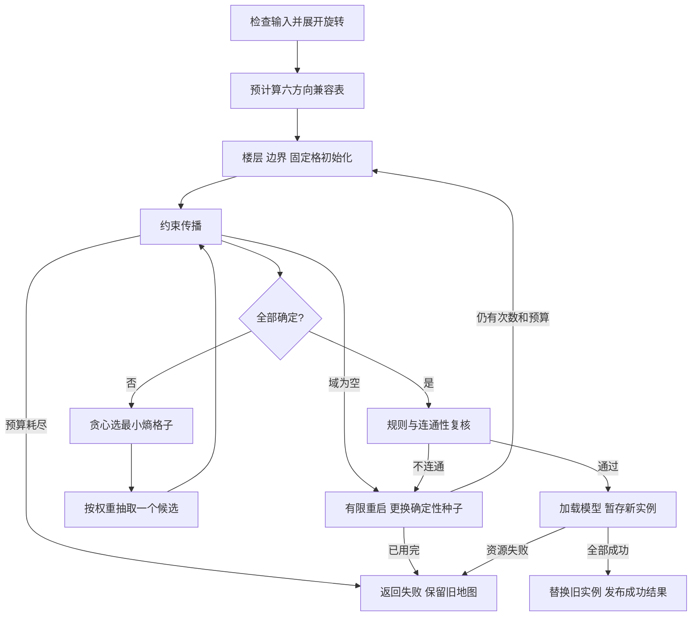

# WFC 算法与贪心策略

## 1. 本模块解决什么问题

输入是一组人工定义的模块、相邻接口和有限网格，输出是每个格子的模块与朝向。它属于**基于模块的约束满足问题**。这里不是从图片学习重叠图案的 WFC，也不是自动从任意模型识别建筑连接面。

参考 [mxgmn 的 WFC](https://github.com/mxgmn/WaveFunctionCollapse) 的观察/传播思路，以及 [Marian42 的建筑 WFC 说明](https://marian42.de/article/wfc/) 中的建筑模块与连接面设计。本插件自行使用 UE C++ 实现，没有引入 Unity 运行时或执行下载仓库中的脚本。

平面模式使用 `+X/-X/+Y/-Y`；立体模式再加 `+Z/-Z`。立体层数在 C++ 中强制为 1～3，不仅依赖编辑器的输入限制。

## 2. 变量、候选和邻接关系

每个格子 `c` 是一个变量，候选域为 `D(c)`。一个候选是“模块定义 + 一个允许的 90° 朝向”，例如 `RoadCorner@90`。

模块最多展开为 256 个候选。候选集合用四个 `uint64` 表示，一个格子 32 字节的域位集。它们存储在求解临时内存中，不创建 Actor。

方向 `d` 上的兼容集合预先计算：

```text
Compatible[d][a] = { b | Socket(a,d) == Socket(b,Opposite(d)) }
```

当前兼容规则为同名 `FName` 接口相等，没有通配、镜像或颜色图形自动识别。旋转会重排水平接口；上下接口视为绕竖轴旋转不变。需要方向敏感上下接口时，使用独立固定朝向模块。

初始化根据以下条件删减每格候选：

- 绝对楼层范围、只允许底层/顶层；
- 外边界名字，立体底边界和顶边界名字；
- 固定坐标的模块 ID 及可选朝向。

固定格先编译为每格位集，初始化时直接查询，避免每个候选重新扫描所有固定格。固定条目最多为网格格数；同一坐标的多个固定条件会取交集，互相冲突时得到空域。

## 3. 贪心的部分：优先决定哪个格子

采用**最小加权 Shannon 熵**策略。对尚未确定、候选数大于 1 的格子，记候选权重为 `w_i > 0`：

```text
W = Σ w_i
H(c) = log(W) - (Σ w_i * log(w_i)) / W
```

每次选择当前 `H(c)` 最小的格子，相当于优先解决约束最强、最容易遇到冲突的位置。候选数/熵在域改变时更新缓存；选择时扫描未确定格子。加入基于当前随机种子的极小扰动，用于打破熵相等的情况。

这就是本模块使用的**局部贪心顺序**：根据当前信息决定下一个格子，不搜索所有未来布局，也不保证建筑美观、道路长度或建筑数量达到全局最优。

## 4. 随机的部分：选中哪个候选

选定格子后，按权重抽取一个候选：

```text
P(variant i | 当前候选域) = w_i / Σ w_j
```

这一步不是“永远选最大权重”。权重是相对偏好；邻接条件、楼层和固定格都会改变实际分布，所以最终数量不等于简单按权重分配。

一个模块允许 `r` 个旋转时，每个变体使用 `Tile.Weight / r`。因此两个形状分别配置 1 和 4 个旋转，不会仅因为旋转多就获得四倍总权重。

确定候选后，该格候选域只保留它。只使用局部 `FRandomStream`，不修改游戏全局随机状态。

## 5. 传播：让相邻格子的条件保持一致

```text
队列 = 所有初始格子
当队列不为空：
    取出格子 c
    对 c 的每个实际邻格 n，方向为 d：
        支持集 S = 合并 Compatible[d][a]，其中 a 属于 D(c)
        新域 = D(n) ∩ S
        若新域为空：记录矛盾坐标，本次尝试失败
        若新域变小：更新 n 的域、候选数和熵；将 n 加入队列
```

初始时对所有格子传播一次；之后只有新坍缩的格子及其受影响邻格进入队列。队列中使用标记去重。传播维持局部弧一致性，但这不意味着剩余候选一定能组成全局解。

每次把一个源候选的兼容位集合并进支持集计为一单位 `PropagationSteps`。预算在所有重启之间共享；耗尽返回 `BudgetExceeded`。它不是严格的墙钟时间预算，编译邻接表、初始化、扫描最小熵和最终复核也会消耗时间。

## 6. 矛盾与重启

本版采用**有限次整图重启**，不保存决策栈，不回退到上一个格子。

第 0 次尝试直接使用 `Settings.Seed`；第 `a` 次重试使用下式的 32 位回绕结果作为有符号种子：

```text
EffectiveSeed = uint32(Seed) + a * 0x9E3779B9
总尝试上限 = MaxRestarts + 1
```

不同重试会走不同的随机决策路径。可满足的问题也可能在有限预算内失败，因此返回 `Contradiction` 表示这些尝试遇到矛盾，不是数学上证明整套规则无解。重复增加重试次数不能修复必然冲突的边界或互斥固定格。

Marian42 的项目还展示了回溯及无限世界扩展，本插件没有宣称已实现这两项。后续需要更大地图时，可以增加决策栈/可逆域更改记录，或按区块生成并把相邻区块边界作为固定条件。

## 7. 完成之后还有两次检查

**规则复核**：完整格子数量、X 最快的坐标顺序、模块 ID/索引/朝向、楼层、边界、固定格、每对相邻接口全部重新检查。结果不能只依赖“候选数已是 1”。

**格子连通性复核**：仅把 `Walkable=true` 的格子作为节点；两格通过已匹配且列于 `TraversableSockets` 的接口连边。用 BFS 统计连通分量。要求连通时，分量必须恰好为 1；零个可行走格也不通过。

楼板 `Floor` 代表支撑，楼梯 `Stair` 代表跨层通行。把二者区分后，没有楼梯的三层楼会得到三个分量并被拒绝，不能因为楼板相接就被判断为可上下楼。

这个图只验证数据描述。错误标记的门、朝向错误的楼梯、走不进去的碰撞、角色净高不足、缺少 NavMesh 都不会凭空被修正。实际可玩场景还需要碰撞/净高/路径验证。本轮只进行编辑器生成与数据复核，没有开始游戏验收角色通行。

## 8. 完整流程



## 9. 复杂度、硬上限与性能

设格数 `N ≤ 4096`，旋转变体 `V ≤ 256`，方向数 `d=4 或 6`：

- 兼容表构建约为 `O(d*V²)`，存储 `O(d*V²/64)`。
- 候选域存储 `O(N*V/64)`，并有 `O(N)` 的熵、数量和队列缓存。
- 每次决定扫描所有未确定格子；最多 `N` 次，所以最小熵选择部分最坏约 `O(N²)`。
- 每次传播合并至多 `V` 个四字位集，传播总量受显式工作预算限制。
- 完成复核和 BFS 约为 `O(N*d)`，模块身份查找还有每格最多 `V` 次的检查。
- HISM 按使用的模块定义分组创建，不是每格一个 Actor；模型加载与实例/碰撞建立另计，不包含在求解耗时中。

平面每轴 1～64，立体每轴 1～64、层数 1～3，但仍需满足总数 4096；例如 `64×64×3` 会被拒绝。重启最多 32 次，传播预算上限 20000000。

硬上限是防止无界工作，不是实时帧率承诺。应先测正式模块的尺寸、候选数和实例碰撞成本。`ElapsedMilliseconds` 是求解与规则检查耗时，不代表完整关卡加载时间。

## 10. 后续扩展顺序

先规范正式模型的 Pivot、格子高度和门/楼梯开口，再补实际导航与角色通行验收；随后加入语义要求（入口到出口、宝箱可达、房间数量、敌人安全出生区）。最后按实际规模决定是否加入回溯、异步取消、分块生成与布局版本存档。
